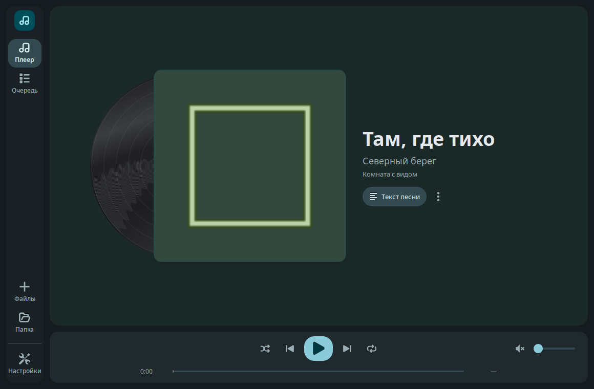

# Veyra

Музыкальный плеер для Linux: локальная очередь, обложки и тексты песен.



[Скачать](https://github.com/68RTF/veyra/releases/latest) · [Установка](#установка) · [Исходный код](https://github.com/68RTF/veyra)

## Возможности

- Добавление файлов и папок, поиск по очереди и изменение порядка треков.
- Перемешивание, повтор, регулировка громкости и скорости.
- Локальные и встроенные тексты песен, поиск недостающих текстов через LRCLIB.
- Локальные обложки и поиск обложек по экспорту плейлиста Яндекс Музыки.
- Загрузка оригиналов с SoundCloud, когда автор разрешил скачивание.

## Установка

Готовые пакеты для x86-64 находятся на [странице релиза v0.7.0](https://github.com/68RTF/veyra/releases/tag/v0.7.0). Скачай пакет для своей системы, открой терминал в папке с ним и выполни команду ниже. Если скачал другую версию, укажи её имя в команде.

### Arch Linux

Скачай `veyra-0.7.0-1-x86_64.pkg.tar.zst`:

```sh
sudo pacman -U ./veyra-0.7.0-1-x86_64.pkg.tar.zst
```

### Ubuntu 24.04

Скачай `veyra_0.7.0_ubuntu24.04_amd64.deb`:

```sh
sudo apt install ./veyra_0.7.0_ubuntu24.04_amd64.deb
```

### Debian 13

Скачай `veyra_0.7.0_debian13_amd64.deb`:

```sh
sudo apt install ./veyra_0.7.0_debian13_amd64.deb
```

### Из исходников

Для сборки нужны Rust и Cargo, заголовки GTK 3 и `pkg-config`. Для работы нужны GTK 3, mpv, ffmpeg с ffprobe и curl. Чтобы сохранять токен SoundCloud в связке ключей, установи также `secret-tool` из libsecret.

В каталоге исходников выполни:

```sh
cargo build --release --locked --bins
install -Dm755 target/release/veyra ~/.local/bin/veyra
install -Dm755 target/release/ym-export ~/.local/bin/ym-export
install -Dm644 veyra.desktop ~/.local/share/applications/veyra.desktop
install -Dm644 assets/veyra.svg ~/.local/share/icons/hicolor/scalable/apps/veyra.svg
```

Для запуска из меню каталог `~/.local/bin` должен быть в `PATH` графической сессии. Подробности сборки пакетов и проверки — в [документации для разработчиков](docs/development.md).

## Использование

Запусти Veyra из меню приложений или командой `veyra`. Добавь файлы или папку кнопками на боковой панели. В очереди открой трек двойным щелчком или клавишей Enter; порядок можно менять перетаскиванием или через меню.

Плеер читает тексты из файлов `.lrc` и `.txt` рядом с аудиофайлом, а также встроенные тексты. Если локального текста нет, Veyra автоматически ищет его в LRCLIB и сохраняет найденное в кэш. Отключить поиск пока нельзя.

## Онлайн-возможности

Для поиска обложек Яндекс Музыки подключи CSV плейлиста в настройках. Там же можно отключить загрузку обложек из интернета. Утилита `ym-export` сохраняет метаданные плейлиста без аудиофайлов:

```sh
ym-export 'PLAYLIST_URL' -o playlist.csv
```

Кнопка загрузки на боковой панели открывает SoundCloud. Veyra скачивает только оригиналы треков, для которых автор включил скачивание. При необходимости можно добавить токен сессии: он сохраняется в связке ключей через `secret-tool`, а если она недоступна — только до закрытия плеера. При пакетной загрузке список пропущенных треков сохраняется в выбранную папку.

## Для разработчиков

Интерфейс написан на Rust и GTK 3, для воспроизведения используется mpv. Команды проверки, сборка пакетов, сведения о хранении данных и CI собраны в [docs/development.md](docs/development.md). Планы — в [ROADMAP.md](ROADMAP.md), историческое ревью — в [REVIEW.md](REVIEW.md).

## Лицензия

Файла лицензии в репозитории пока нет. Условия повторного использования кода не указаны.
